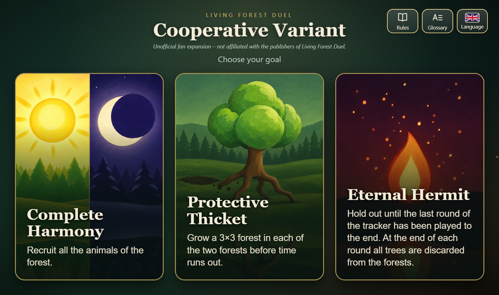

# LFD Koop – companion app for a cooperative variant of Living Forest Duel

## 👉 [**Try it live in your browser!**](https://gthts.github.io/lfd-koop-app/)

No installation needed: the full app runs right here in your browser, on a PC, tablet or phone (best in landscape, about 1280 × 800 pixels).

**Download the Android app:** [Releases](../../releases)

> **Unofficial fan expansion.** This project is not made by, and not affiliated with, the publisher of Living Forest Duel (Ludonaute). All artwork in the app is original; no artwork from the game is used. All trademarks and game names belong to their respective owners.

## What is this?

*Living Forest Duel* is actually a **competitive two-player game**: Summer and Winter play against each other. This project turns it into a **cooperative variant**: both players are on the same side and fight the Onibi together, whose behaviour is steered by a deck of event cards.

> **You need the base game.** This app is not a game of its own and contains none of the game's components. You play with the real components of *Living Forest Duel* on the table, and the app only takes over the Onibi's event deck. So you really have to **own the base game** (if you do not own it yet, buy it first; it is a wonderful game and worth having anyway).

The app replaces that event deck. You keep playing **with the components on the table**; the app shuffles and draws the 47 event cards, shows the round tracker and keeps track of the display, the discard pile and reshuffling.

**Why play it cooperatively?** The cooperative variant opens up new ways to experience the game and its interesting mechanics all over again. Together you solve the puzzle in every single turn and plan the optimal combo. And sometimes you simply have to shrug off bad luck, together.

## Key features

- **Cooperative play against the Onibi** with three goals: Complete Harmony, Protective Thicket, Eternal Hermit.
- **Four round trackers** (Training, Standard, Hardcore and the Short game for Protective Thicket) set the intensity, the start of the partner forest and the end of the game.
- **47-card event deck**, drawn by touch. Cards of the same category may not lie in the display together (“uh-oh”, the new card goes to the discard pile); the Onibi seal at the top left of each card shows its category.
- **Complete rules and glossary** inside the app, searchable, covering every difference from the base game (no player order, revealing together, Sanki, partner forest, bonus actions, …).
- **Entirely original artwork:** event cards, round trackers, reference card and goal pictures (all artifacts of this project were generated by a human using AI tools, see [LICENSE-ASSETS.md](LICENSE-ASSETS.md)).
- **Localised in German, English and Korean** (interface, cards, rules, glossary).
- Works **offline and without a server**: plain HTML, CSS and JavaScript without libraries, shown in a WebView on Android and straight from the files in a desktop browser.

## Showcase

| Game screen (German) | Rules (English) | Glossary (Korean) |
|---|---|---|
|  |  |  |

## Install and try

- **Android tablet (recommended, landscape):** download the signed APK from [Releases](../../releases), copy it to the device and open it (allow installation from unknown sources). Requires Android 8.0 or newer.
- **In your browser:** [Try it live](https://gthts.github.io/lfd-koop-app/) (no installation; the web version is hosted on GitHub Pages, see [docs/BUILD.md](docs/BUILD.md#web-version-github-pages)). Or open `app/src/main/assets/www/index.html` from a download of this repository (a double-click is enough).

## Layout

- `app/src/main/assets/www/`: the whole interface and game logic (`index.html`, `style.css`, `data.js`, `app.js`, `i18n.js`, `anleitung.js` = rules, `glossar.js` = glossary, `img/`).
- `app/src/main/java/…/MainActivity.java`: shows it in a WebView (fullscreen, screen stays on).
- `bauen_android.ps1`, `build.gradle`, `settings.gradle`: building the APK, see [docs/BUILD.md](docs/BUILD.md).
- `tools/publish_web.ps1`: updates the web version (the `gh-pages` branch).

## Status

Version **1.8.5**.

## License

- **Program code:** [MIT](LICENSE)
- **Artwork and texts** (images, rules, glossary, interface and card texts, screenshots): [CC BY 4.0](LICENSE-ASSETS.md), please credit “LFD Koop by github_ts@online.de”
- *Living Forest Duel* and its trademarks, artwork and rules text belong to their owners and are not covered; see the notice at the top.
