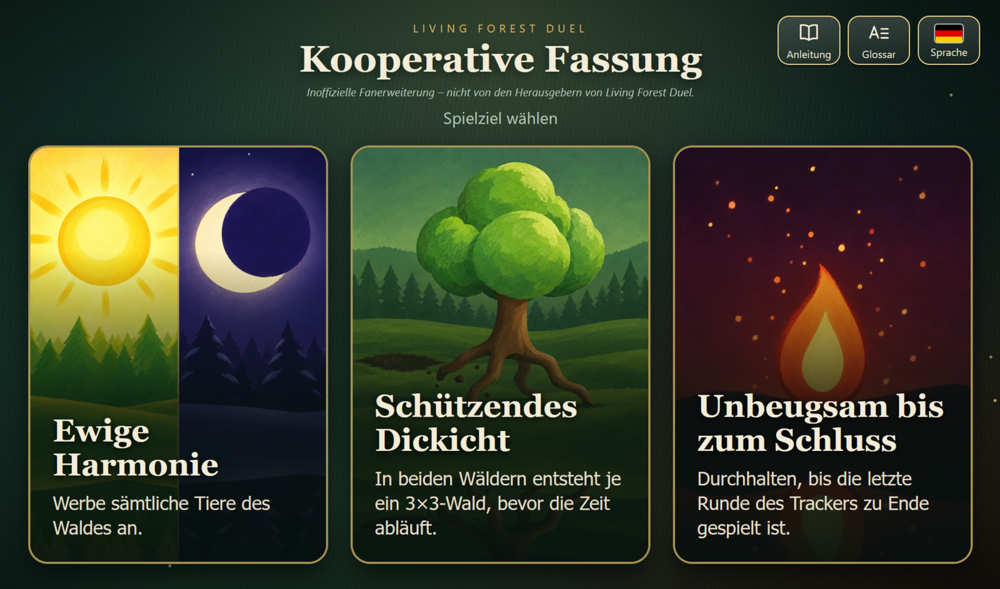
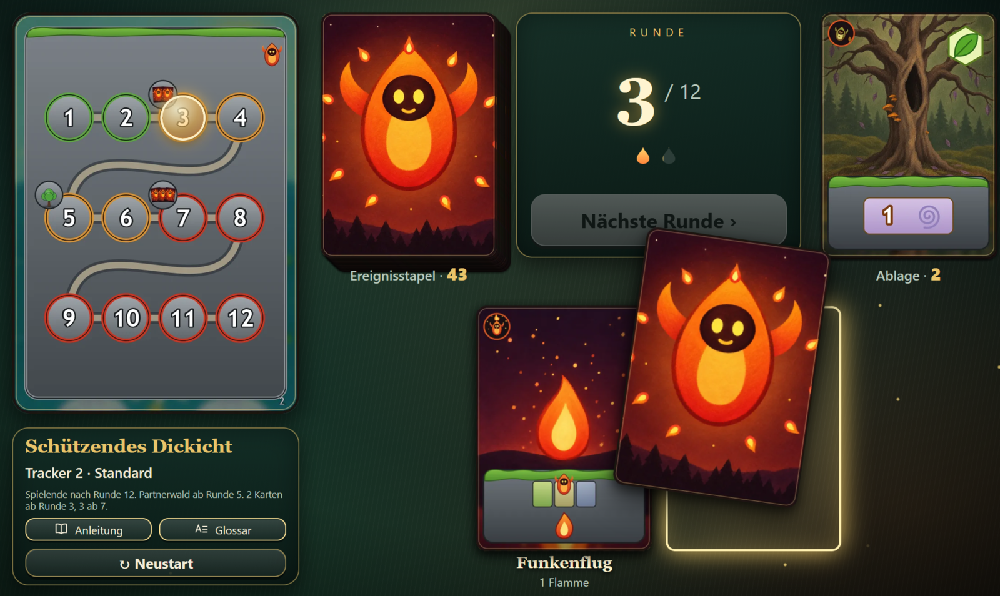
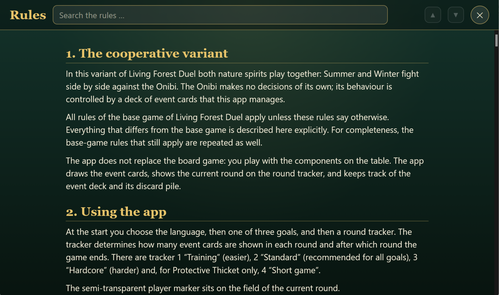
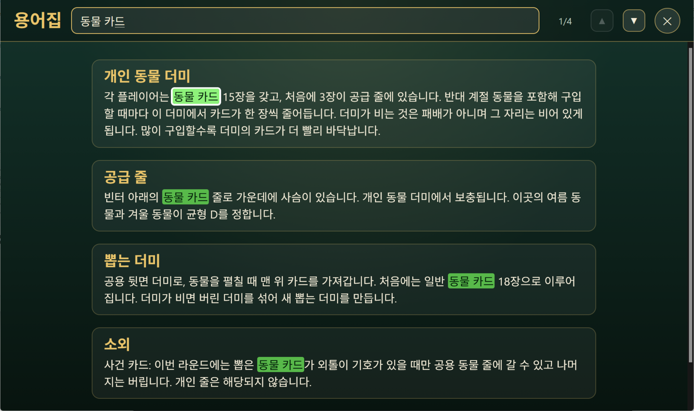

# LFD Koop – Begleit-App für eine kooperative Fassung von Living Forest Duel

*Deutsch · [English below](#english)*

> **Inoffizielle Fanerweiterung.** Dieses Projekt stammt nicht vom Verlag von Living Forest Duel (Ludonaute) und ist nicht mit ihm verbunden. Das gesamte Artwork der App ist eigenes Material; es werden keine Originalbilder des Spiels verwendet. Alle Marken und Spielnamen gehören ihren jeweiligen Inhabern.

## Worum geht es?

*Living Forest Duel* ist ein eigentlich **kompetitives Spiel für zwei Personen**: Sommer und Winter spielen gegeneinander. Dieses Projekt macht daraus eine **kooperative Variante**: Beide Spieler stehen auf einer Seite und kämpfen gemeinsam gegen den Onibi, dessen Verhalten ein Stapel Ereigniskarten steuert.

Die App ersetzt dafür den Ereignisstapel. Gespielt wird weiterhin **mit dem Spielmaterial am Tisch**; die App mischt und zieht die 47 Ereigniskarten, zeigt den Rundentracker und führt Auslage, Ablage und Neumischen.

## Wesentliche Merkmale

- **Kooperatives Spiel gegen den Onibi** mit drei Spielzielen: Ewige Harmonie, Schützendes Dickicht, Unbeugsam bis zum Schluss.
- **Vier Rundentracker** (Training, Standard, Hardcore und das Kurzspiel fürs Dickicht) bestimmen Intensität, Beginn des Partnerwaldes und Spielende.
- **Ereignisstapel mit 47 Karten**, gezogen per Berühren; Karten derselben Kategorie dürfen nicht gemeinsam in der Auslage liegen („Oh-Oh“ und Ablage), das Onibi-Siegel oben links zeigt die Kategorie.
- **Vollständige Anleitung und Glossar** in der App, durchsuchbar, mit allen Abweichungen vom Grundspiel (keine Spielerreihenfolge, gemeinsames Aufdecken, Sanki, Partnerwald, Bonusaktionen, …).
- **Komplett eigenes Artwork:** Ereigniskarten, Rundentracker, Referenzkarte und Zielbilder.
- **Lokalisiert** in **Deutsch, Englisch und Koreanisch** (Oberfläche, Karten, Anleitung, Glossar).
- Läuft **ohne Server und ohne Netzverbindung**: reines HTML, CSS und JavaScript ohne Bibliotheken, in Android in einer WebView, im Browser direkt aus den Dateien.

## Vorschau

| Spielfläche | Anleitung (Englisch) | Glossar (Koreanisch) |
|---|---|---|
|  |  |  |

## Installieren und ausprobieren

- **Android-Tablet (empfohlen, Querformat):** Die signierte APK steht unter [Releases](../../releases). Datei auf das Gerät kopieren und öffnen (Installation aus unbekannter Quelle erlauben). Voraussetzung: Android 8.0 oder neuer.
- **Am PC im Browser:** `app/src/main/assets/www/index.html` direkt öffnen (Doppelklick genügt, am besten bei etwa 1280 × 800 Bildpunkten). Alternativ als Webseite über GitHub Pages, siehe [docs/BAUEN.md](docs/BAUEN.md#webseite-über-github-pages).

## Aufbau

- `app/src/main/assets/www/`: die gesamte Oberfläche und Spiellogik (`index.html`, `style.css`, `data.js`, `app.js`, `i18n.js`, `anleitung.js`, `glossar.js`, `img/`).
- `app/src/main/java/…/MainActivity.java`: zeigt sie in einer WebView (Vollbild, Bildschirm bleibt an).
- `bauen_android.ps1`, `build.gradle`, `settings.gradle`: Bau der APK, siehe [docs/BAUEN.md](docs/BAUEN.md).

## Stand

Version **1.4.2**. Lizenz: noch nicht festgelegt (alle Rechte vorbehalten). Das Projekt ist zunächst privat.

---

# LFD Koop – companion app for a cooperative variant of Living Forest Duel

> **Unofficial fan expansion.** This project is not made by, and not affiliated with, the publisher of Living Forest Duel (Ludonaute). All artwork in the app is original; no artwork from the game is used. All trademarks and game names belong to their respective owners.

*Living Forest Duel* is actually a **competitive two-player game**: Summer and Winter play against each other. This project turns it into a **cooperative variant**: both players are on the same side and fight the Onibi together, whose behaviour is steered by a deck of event cards.

The app replaces that event deck. You keep playing **with the components on the table**; the app shuffles and draws the 47 event cards, shows the round tracker and keeps track of the display, the discard pile and reshuffling.

**Key features:** cooperative play against the Onibi with three goals · four round trackers (Training, Standard, Hardcore, Short game) · 47-card event deck with category rule (“uh-oh”) · complete searchable rules and glossary · **entirely original artwork** · **localised in German, English and Korean** · works offline, no server, no libraries.

**Try it:** download the signed APK from [Releases](../../releases) (Android 8.0+, tablet in landscape), or open `app/src/main/assets/www/index.html` in a desktop browser. A web version via GitHub Pages is described in [docs/BAUEN.md](docs/BAUEN.md#webseite-über-github-pages).

Version **1.4.2** · licence not yet defined (all rights reserved) · the repository is private for now.
